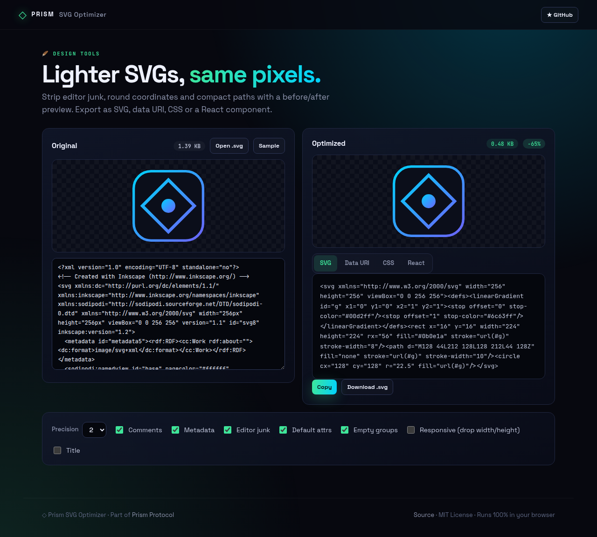
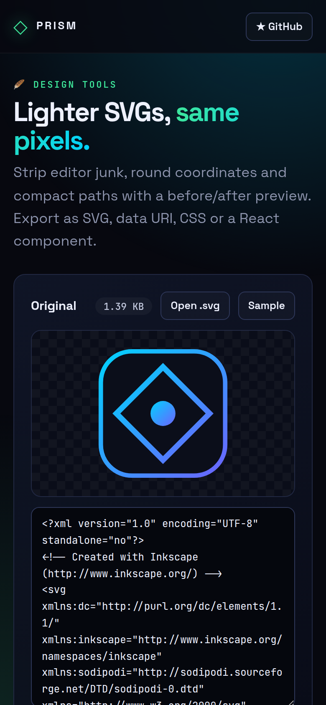

<!-- ═════════════ HEADER ═════════════ -->
<p align="center">
  
</p>

<p align="center">
  
</p>

<p align="center">
  <a href="https://github.com/krishyaa06/prism-svg-optimizer/actions/workflows/ci.yml"></a>
  <a href="https://krishyaa06.github.io/prism-svg-optimizer/"></a>
  
  
  <a href="LICENSE"></a>
</p>

<p align="center">
  
</p>


## ⚡ Overview

**Prism SVG Optimizer** makes SVG files smaller without changing how they look. It removes XML declarations, comments, metadata and editor namespaces from Inkscape, Illustrator, Sketch and Figma, drops default attributes, rounds numbers to your chosen precision, compacts path data and flattens empty groups. Before/after previews let you confirm nothing broke, and the result can be exported as raw SVG, a data URI, a CSS background or a React component.

## ✨ Features

- **Removes** XML/doctype, comments, `<metadata>`, editor namespaces and auto-generated ids
- **Rounds** coordinates (precision 0–3) and **compacts** `d` / `points` data
- **Drops default attributes** and empty groups / defs
- **Responsive mode**: swaps width/height for a viewBox
- **Before/after preview** on a transparency checkerboard, size savings in %
- **Export** as SVG, data URI, CSS `background-image` or **React JSX** component

## 📸 Screenshots

<table>
  <tr>
    <td width="68%"></td>
    <td width="32%"></td>
  </tr>
</table>

## 🚀 Quick Start

**Use it online:** [https://krishyaa06.github.io/prism-svg-optimizer/](https://krishyaa06.github.io/prism-svg-optimizer/)

**Run locally:**

```bash
git clone https://github.com/krishyaa06/prism-svg-optimizer.git
cd prism-svg-optimizer
# open index.html in your browser, or serve it:
npx serve .
```

## 🛠️ Usage

1. Paste SVG markup, open a file, or drop one onto the page.
2. Tune precision and toggles; compare the two previews.
3. Pick **SVG / Data URI / CSS / React** and copy or download.

## 📁 Project Structure

```text
prism-svg-optimizer/
├── assets/
│   ├── logo.png
│   └── logo.svg
├── css/
│   ├── app.css
│   └── prism.css
├── js/
│   ├── app.js   # UI wiring
│   ├── core.js   # optimizer + exporters — tested in Node
│   └── prism.js
├── test/
│   └── core.test.js
├── .gitignore
├── LICENSE
├── README.md
├── index.html
└── package.json
```

## 🧪 Tests

```bash
npm test
```

Tests use the built-in `node:test` runner, so there is nothing to install. CI runs them on Node 20 and 22.

## 🤝 Contributing

1. Fork the repo and create a branch: `git checkout -b feature/my-idea`
2. Make your change and add a test in `test/`
3. Run `npm test` and open a Pull Request

## 🔷 Part of Prism Protocol

Prism SVG Optimizer is one of the open-source tools built by [Prism Protocol](https://dc.gg/prismprotocol), a tech community where young builders learn, ship and compete together.

## 👤 Author

<table>
  <tr>
    <td align="center">
      <a href="https://github.com/krishyaa06"><br><b>Soumya Bhandare</b></a><br>
      <sub>Founder @ Prism Protocol</sub>
    </td>
    <td>
      <a href="https://dc.gg/prismprotocol"></a><br>
      <a href="https://instagram.com/prism_protocol_"></a><br>
      <a href="https://x.com/krishyaa06"></a>
    </td>
  </tr>
</table>

## 📄 License

Released under the [MIT License](LICENSE).

<p align="center">
  <b>If you like this project, consider giving it a ⭐</b><br>
  <sub>"Build. Create. Compete." · Made with ⚡ by Prism Protocol</sub>
</p>


